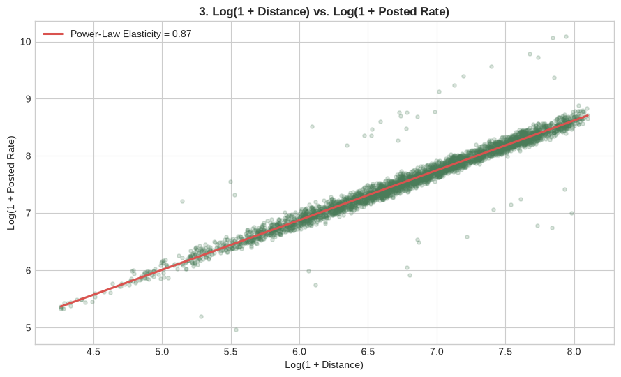
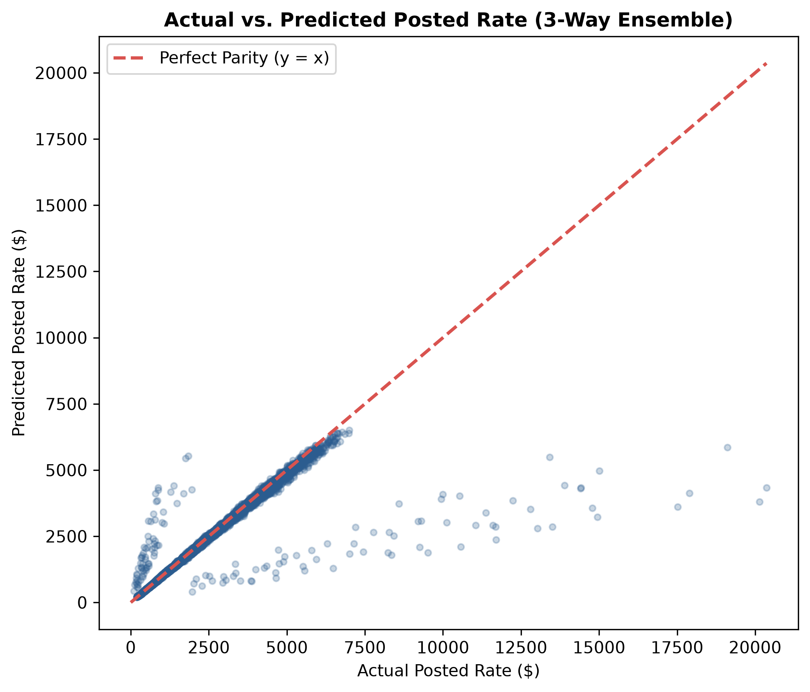

# Freight Rate Prediction & Lane Forecasting

End-to-end machine learning pipeline for predicting truckload spot freight rates (`posted_rate`) across U.S. shipping lanes and forecasting daily December 2025 rates for the **Lexington $\rightarrow$ Fort Wayne** corridor.

---

## 1. Executive Summary

* **Modeling Objective:** Predict `posted_rate` (USD) from shipment distance, equipment type, freight weight, origin/destination coordinates, market indices, quote signals, and temporal features.
* **Best Single Model Families:** **Log-ElasticNet** (`CV Log-RMSE = 0.15265`, `Test MAE = $115.56`) won among linear models, while **Log-LightGBM** (`Test MAE = $115.77`, `Test R² = 0.8249`) led the tree-based models.
* **Final Production Architecture:** A **3-Way Log-Space Ensemble (`ElasticNet` + `LightGBM` + `XGBoost`)** achieving **$111.33 MAE**, **4.64% MAPE**, and **$R^2 = 0.8249$** on the out-of-time test split, combining linear power-law extrapolation with cross-booster variance reduction.

---

## 2. Data Cleaning & Chronological Splitting

* **Missing Value & Validity Filtering:** Removed `374` null `market_index` rows and `300` null `weight` rows (~0.7% of `48,000` raw loads), enforced strictly positive `weight > 0` and `distance > 0`, and deduplicated records (`47,038` clean loads).
* **Target Leakage Prevention:** Dropped `load_id`, raw city names (`pickup`, `delivery`, `route`), and `rate_per_mile` (`posted_rate / distance`).
* **Temporal Train/Test Split (80/20):** Because `validation.csv` (`12,000` loads) covers a future period (November–December 2025), `train-test.csv` was sorted chronologically by `date` and split sequentially—first **80% (`37,630` loads)** for training and most recent **20% (`9,408` loads)** as an out-of-time holdout test set.

---

## 3. Exploratory Data Analysis & Feature Engineering

*Figure 1: Mean and median posted rates by month, day of month, and day of week on the training split[cite: 1].*

* **Temporal Feature Selection (`pickup_month`, `pickup_day`, Dropping `dayofweek`):**
  * Retained `pickup_month` to capture strong macro-seasonality—mean rates rise **+10.6%** from January (~$2,256) to June (~$2,496) before moderating in Q3[cite: 1].
  * Retained `pickup_day` to capture potential end-of-month shipping surges[cite: 1].
  * **Dropped `pickup_dayofweek`:** No meaningful weekly cycle was detected—weekday averages fluctuate within a narrow ~$70 window ($2,335 Sun to $2,405 Wed, ~3%)[cite: 1], so excluding it prevents redundant calendar noise.

*Figure 2: Log-log relationship between shipment distance and posted rate showing strong power-law linearity[cite: 2].*

* **Target & Power-Law Transformations:**
  * Applied $\log(1 + y)$ (`np.log1p`) to stabilize right-skewed dollar rates and inverted predictions back to USD via $\exp(\hat{y}) - 1$ (`np.expm1`)[cite: 2, 3].
  * Added `log_distance = np.log1p(distance)` to capture power-law distance elasticity[cite: 3].
* **Spatial Geometry Features:**
  * Computed great-circle `haversine_miles` from origin/destination coordinates[cite: 3].
  * Engineered `detour_ratio = distance / max(haversine_miles, 1.0)` along with directional vectors (`delta_lat`, `delta_lon`)[cite: 3].
* **Model-Specific Collinearity Control:**
  * Dropped raw `distance` from the `linear` feature matrix to eliminate severe multicollinearity ($\text{VIF} > 50$) while retaining both `distance` and `log_distance` for tree-based splits[cite: 3].

---

## 4. Evaluation Metrics Guide

| Metric | What It Measures | Interpretation |
| :--- | :--- | :--- |
| **MAE ($)** | Mean Absolute Error — average absolute dollar miss across all loads. | **Lower is better.** Robust to extreme outliers; reflects typical per-load pricing accuracy. |
| **MAPE (%)** | Mean Absolute Percentage Error — average relative error as a % of actual rate. | **Lower is better.** Measures scale-independent pricing accuracy across short and long hauls. |
| **$R^2$** | Coefficient of Determination — proportion of variance in `posted_rate` explained by the model. | **Higher is better (max 1.0).** Indicates strong explanatory fit across market and distance regimes. |
| **VIF** | Variance Inflation Factor — degree of multicollinearity among linear predictors. | **Lower is better (< 5–10 ideal).** High VIF ($> 50$) destabilizes linear regression coefficients. |

---

## 5. Model Benchmarking & Hyperparameter Tuning

### Best-in-Family Winners & Tuned Hyperparameters (5-Fold CV)

* **Best Linear Model Family (`Log-ElasticNet`):** Achieved the lowest 5-fold cross-validation error (`CV Log-RMSE = 0.15265 ± 0.00257`), outperforming `Log-Ridge` (`0.15311`) by combining L1/L2 shrinkage across correlated spatial and market features.
* **Best Tree-Based Model Family (`Log-LightGBM`):** Tied `Log-XGBoost` on CV (`0.15940` vs. `0.15930`) while delivering the strongest single-model holdout accuracy (`Test MAE = $115.77`, `Test R² = 0.8249`).

| Model Family | Best-in-Family Status | CV Log-RMSE | Tuned Hyperparameters |
| :--- | :--- | :---: | :--- |
| **Log-ElasticNet** | **Best Linear Model** | **0.15265** | `alpha=0.01`, `l1_ratio=0.1` |
| **Log-Ridge** | Runner-Up Linear | 0.15311 | `alpha=100.0` |
| **Log-LightGBM** | **Best Tree Model** | **0.15940** | `n_estimators=300`, `learning_rate=0.03`, `num_leaves=31`, `min_child_samples=50`, `subsample=0.8`, `colsample_bytree=0.8`, `reg_alpha=0.1`, `reg_lambda=0.0` |
| **Log-XGBoost** | Runner-Up Tree | 0.15930 | Tuned 5-fold CV GBDT (depth-wise regularized tree booster) |
| **Log-RandomForest** | Bagging Baseline | 0.15940 | Tuned 5-fold CV ensemble of bagged decision trees |

### Out-of-Time Holdout Test Comparison (9,408 Loads)

| Model | Test RMSE ($) | Test MAE ($) | Test MAPE (%) | Test $R^2$ |
| :--- | :---: | :---: | :---: | :---: |
| Log-RandomForest (Tuned) | $639.71 | $121.21 | 5.23% | 0.8241 |
| Log-XGBoost (Tuned) | $639.09 | $116.20 | 4.96% | 0.8245 |
| Log-LightGBM (Tuned) | $638.39 | $115.77 | 4.95% | 0.8249 |
| Log-ElasticNet (Tuned) | $639.81 | $115.56 | 4.83% | 0.8241 |
| Log-Ridge (Tuned) | $637.57 | $110.52 | 4.75% | 0.8253 |
| Ensemble: 50% ElasticNet + 50% LightGBM | $638.36 | $111.24 | 4.62% | 0.8249 |
| **Ensemble: ElasticNet + LightGBM + XGBoost** | **$638.41** | **$111.33** | **4.64%** | **0.8249** |

*Figure 3: Holdout test actual vs. predicted posted rates demonstrating strong alignment across standard rate tiers.*

* **Why RMSE (~$638) Is Higher Than MAE (~$111):** Error diagnostics revealed 5 extreme spot-rate outliers in the holdout split (`$17,514–$20,362` actual rates vs. `$3,603–$5,829` predicted, with single-load residuals of `$13.3k–$16.3k`). Because RMSE squares errors, those rare spikes dominate RMSE while typical predictions stay within **4.64% MAPE**.
* **Why the 3-Way Blend Was Selected Over the 2-Way Blend:**
  * The **$0.05 RMSE** (`638.36` vs. `638.41`) and **$0.09 MAE** (`111.24` vs. `111.33`) gap between the 2-way and 3-way blends is statistically negligible at identical **$R^2 = 0.8249$**.
  * **Linear + Non-Linear Balance:** `ElasticNet` preserves smooth power-law distance and market-index trends where tree models flatten out.
  * **Cross-Booster Variance Reduction:** Splitting non-linear weight across **LightGBM** (leaf-wise growth) and **XGBoost** (depth-wise growth) dampens single-tree split variance for stronger out-of-time stability on November–December 2025.

---

## 6. Inference & December 2025 Lane Forecast

* **Serialized Pipeline (`saved_models/final_spotter_ensemble.joblib`):** Bundles fitted `ElasticNet`, `LightGBM`, and `XGBoost` models alongside training medians, exact column schemas, and blend weights[cite: 3].
* **Zero-Row-Drop Validation Scoring (`validation.csv`):** Imputes any missing numeric fields using saved training medians, aligns one-hot and spatial schemas, and outputs `data/validation_predictions.csv` across all `12,000` validation loads with zero nulls[cite: 3].
* **December 2025 Corridor Forecast (`december-chart-inputs.csv`):**
  * Enriched the **Lexington $\rightarrow$ Fort Wayne** (`Dry Van`, `360` miles, `32,000` lbs) inputs with median origin/destination coordinates and lane-level `market_index` and `quote_signal` lookups from `train-test.csv` (with global median fallback)[cite: 3].
  * Generated 31 daily forecasts for December 1–31, 2025, projecting rates rising smoothly from **$828.63 (Dec 1)** to **$834.11 (Dec 10)**[cite: 3] and across the remainder of the month.