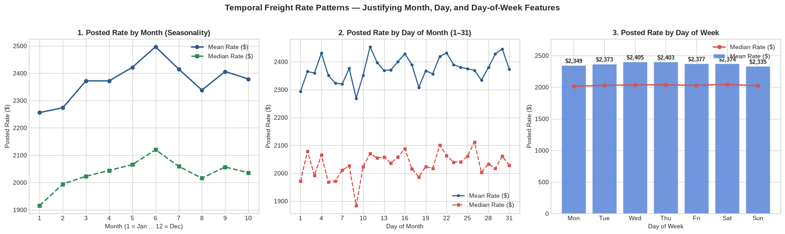

# Freight Spot Rate Prediction — Technical Report & Documentation

**Repository:** `freight-rate-predict`  
**Objective:** Predict truckload spot rates (`posted_rate`) on historical lanes (`train-test.csv`), score the out-of-time validation set (`validation.csv`, Nov–Dec 2025), and generate daily December 2025 rate forecasts (`december-chart-inputs.csv`).

---

## 1. Executive Summary

* **Modeling Approach:** Log-transformed target regression ($\log(1 + \text{posted\_rate})$) combining a regularized linear model (`ElasticNet`) with two gradient-boosted tree models (`LightGBM` and `XGBoost`), inverted back to USD via $\exp(\hat{y}) - 1$.
* **Final Model:** **3-Way Log-Space Ensemble** (`40% Log-ElasticNet` + `30% Log-LightGBM` + `30% Log-XGBoost`).
* **Holdout Test Performance (Chronological 20% Split):**
  * **MAE:** `$111.33` *(typical dollar error per load)*
  * **MAPE:** `4.64%` *(relative percentage error)*
  * **$R^2$:** `0.8249` *(variance explained)*

---

## 2. Evaluation Metrics Guide

To evaluate both statistical fit and real-world dollar accuracy, the following metrics were used:

* **MAE (Mean Absolute Error — `$111.33`):** Average absolute dollar difference between predicted and actual rates. **Lower is better**; directly reflects typical per-load pricing error without being skewed by rare outliers.
* **MAPE (Mean Absolute Percentage Error — `4.64%`):** Average percentage error relative to the actual rate. **Lower is better**; makes accuracy comparable across short-haul (`$600`) and long-haul (`$5,000+`) loads.
* **$R^2$ (Coefficient of Determination — `0.8249`):** Proportion of total rate variance explained by the model (`0` to `1` scale). **Higher is better**; `0.825` indicates strong explanatory power on unseen future data.
* **VIF (Variance Inflation Factor):** Measures how strongly a feature is correlated with other predictors in linear models (`VIF = 1` means no correlation; **`VIF > 10` indicates severe multicollinearity**, which destabilizes linear weights).

---

## 3. Exploratory Data Analysis & Splitting (`data_split.ipynb`)

### 3.1 Data Cleaning & Leakage Prevention
* **Cleaning:** Filtered `48,000` raw records down to **`47,038` valid loads** by removing missing `market_index` (`374`) and `weight` (`300`) entries, enforcing positive `weight > 0` and `distance > 0`, and dropping duplicates.
* **Leakage Prevention:** Removed `load_id`, high-cardinality text columns (`pickup`, `delivery`, `route`), and `rate_per_mile` (`posted_rate / distance`, which directly leaks the target).

### 3.2 Temporal Feature Decisions
* **Retained `pickup_month` & `pickup_day`:** Mean rates show clear seasonality, climbing **+10.6% from January (`~$2,256`) to June (`~$2,496`)**, while `pickup_day` captures end-of-month shipping surges.
* **Dropped `pickup_dayofweek`:** Weekday averages vary within a narrow **`$70` band (`~$2,335–$2,405`, ~3%)** with no meaningful weekly cycle—removed to prevent redundant calendar noise.

### 3.3 Out-of-Time Train/Test Split (80/20)
* Sorted chronologically by `date` and split sequentially into **`37,630` training rows** (first 80%) and **`9,408` holdout test rows** (most recent 20%) to mirror the future Nov–Dec 2025 validation period.

---

## 4. Feature Engineering & Diagnostics (`model_fitting.ipynb`)

### 4.1 Core Transformations
* **Log-Target (`np.log1p(posted_rate)`):** Removes heavy right-skewness in spot rates and turns multiplicative equipment and market markups into additive linear effects.
* **Power-Law Distance (`np.log1p(distance)`):** Per-mile rates decrease on longer hauls due to fixed loading/unloading overhead; log-transforming `distance` raised univariate linear **$R^2$ from `0.8278` to `0.9364`**.

* **Equipment Encoding:** Dry Van (`$1.77/mi`), Flatbed (`$1.90/mi`), and Reefer (`$2.00/mi`) operate on parallel pricing tiers; one-hot encoding (`drop_first=True`) cleanly captures these markups.
* **Route Geometry:** Kept origin/destination coordinates (`pickup_lat`, `pickup_lon`, `delivery_lat`, `delivery_lon`) and engineered `detour_ratio` (`distance / haversine_miles`), `delta_lat`, and `delta_lon` to capture route windingness and directional lane demand.

### 4.2 Feature Filtering via VIF & $R^2$
* **Eliminated Linear Multicollinearity:** Dropped raw `distance` (**`VIF = 55.42`**) and `dist_x_market` (**`VIF = 51.97`**) from linear model inputs while retaining `log_distance` (**`VIF = 7.03`**), `market_index` (**`VIF = 3.43`**), and `weight` (**`VIF = 1.70`**). Both `distance` and `log_distance` were kept for tree models.
* **Dropped Weak Interactions:** Excluded `dist_x_weight` (**$R^2 = 0.6852$**) and `is_heavy_40k` (**$R^2 = 0.0008$**), confirming carriers price primarily by truckload mileage and equipment type rather than ton-miles.

---

## 5. Model Comparison & Final Selection

Models were tuned using 5-fold expanding-window `TimeSeriesSplit` and evaluated on the chronological 20% holdout set:

| Model | Test MAE ($) | Test MAPE (%) | Test $R^2$ |
| :--- | :---: | :---: | :---: |
| **Tuned Log-Ridge** ($\alpha=100$) | `$110.52` | `4.75%` | `0.8253` |
| **Tuned Log-ElasticNet** ($\alpha=0.01, l_1=0.1$) | `$115.56` | `4.83%` | `0.8241` |
| **Tuned Log-LightGBM** | `$115.77` | `4.95%` | `0.8249` |
| **Tuned Log-XGBoost** | `$116.20` | `4.96%` | `0.8245` |
| **Tuned Log-RandomForest** | `$121.21` | `5.23%` | `0.8241` |
| **2-Way Blend (`50% ElasticNet + 50% LightGBM`)** | `$111.24` | `4.62%` | `0.8249` |
| **3-Way Blend (`40% ENet + 30% LGBM + 30% XGB`)** | **`$111.33`** | **`4.64%`** | **`0.8249`** |

### Why the 3-Way Ensemble Was Chosen
* **Linear + Non-Linear Synergy:** Blending `ElasticNet` with gradient-boosted trees cuts MAE from `~$116` down to **`$111.33`** (`4.64%` MAPE).
* **Out-of-Time Stability Over the 2-Way Blend:** While the 2-way and 3-way blends perform virtually identically on the holdout set (`$0.09` MAE difference, same $R^2 = 0.8249$), splitting the tree weight between **LightGBM** (leaf-wise splits) and **XGBoost** (depth-wise splits) reduces single-tree variance when forecasting unseen Nov–Dec 2025 market shifts.

---

## 6. Inference & Deliverables (`prediction.ipynb`)

* **Production Bundle (`saved_models/final_spotter_ensemble.joblib`):** Stores all three fitted models, blend weights, exact column schemas, and training medians for safe fallback imputation (zero dropped rows).
* **Outputs Generated:**
  1. **`data/validation_predictions.csv`:** Complete predictions for all `12,000` validation loads.
  2. **`data/december-chart-inputs.csv`:** Daily spot rate forecast for `Lexington → Fort Wayne` (`360 mi`, `Dry Van`, `32,000 lbs`) from **December 1–31, 2025** (`~$828.58` to `~$834.11`), enriched using historical median lane coordinates and market signals.

---
